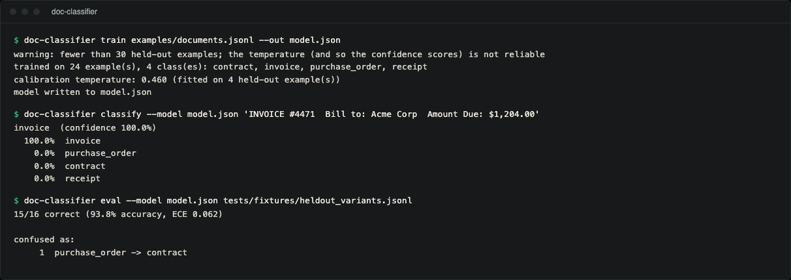

# doc-classifier

Classify business documents (invoices, receipts, contracts, purchase orders,
or whatever labels you train on) from their text and layout. It is a Naive
Bayes classifier with a training CLI, and its confidence scores are corrected
by temperature scaling so that "90%" can be checked against how often it is
actually right. Python 3.10+ and the standard library, nothing else.

## Demo



Real terminal capture. The same session as text:

```console
$ doc-classifier train examples/documents.jsonl --out model.json
warning: fewer than 30 held-out examples; the temperature (and so the confidence scores) is not reliable
trained on 24 example(s), 4 class(es): contract, invoice, purchase_order, receipt
calibration temperature: 0.460 (fitted on 4 held-out example(s))
model written to model.json
$ doc-classifier classify --model model.json 'INVOICE #4471  Bill to: Acme Corp  Amount Due: $1,204.00'
invoice  (confidence 100.0%)
  100.0%  invoice
    0.0%  purchase_order
    0.0%  contract
    0.0%  receipt
$ doc-classifier eval --model model.json tests/fixtures/heldout_variants.jsonl
15/16 correct (93.8% accuracy, ECE 0.062)

confused as:
     1  purchase_order -> contract
```

The bundled example set is tiny (24 documents), so the calibration step
sees only 4 held-out documents and *sharpens* the scores (temperature < 1)
rather than softening them, and the tool warns about it. Calibrated
confidence needs a realistic training set (the warning disappears at 30+
held-out documents); the numbers above demonstrate the mechanics, not a
calibration result.

## Why calibration is the point, not a footnote

Naive Bayes is a famously *overconfident* classifier. Its independence
assumption double-counts correlated evidence, so raw scores routinely say
"99.9%" about predictions that are wrong one time in five. `train` fits the
classifier, then holds out a stratified per-class slice and finds the
softmax temperature that minimises negative log-likelihood on it: one
scalar, found by golden-section search, that pulls the probabilities back
toward what actually happens. `eval` reports **Expected Calibration Error**
(ECE) alongside accuracy, so a claim of "well-calibrated" is checkable
rather than asserted.

## Features

- **Bag-of-words** tokens with Laplace smoothing (crude, deliberately: domain vocabulary like
  "remit to" or "purchase order" is exactly what generic stopword lists
  strip).
- **Layout signals**: digit density, table-like line ratio, ALL-CAPS header
  line ratio, average tokens per line (Gaussian per class), and whether a
  currency amount appears (Bernoulli per class). They are modelled
  separately, not folded into the word vocabulary.
- **Calibration** by temperature scaling on a per-class stratified hold-out
  (`--holdout-fraction`, default 0.2), stored in the model JSON.
- **Evaluation** with accuracy, Expected Calibration Error and a confusion
  list, as text or `--format json`.

## Install

Not published on PyPI (the name `doc-classifier` there is an unrelated
project). Install from a clone:

```console
git clone https://github.com/hellpuffyt/doc-classifier && cd doc-classifier
python3 -m venv .venv && . .venv/bin/activate
pip install .
```

`python -m doc_classifier` works the same as the `doc-classifier` script.

## Usage

```console
doc-classifier train data.jsonl --out model.json [--holdout-fraction 0.2]
doc-classifier classify --model model.json 'some document text' [--format json]
doc-classifier classify --model model.json < document.txt   # stdin
doc-classifier eval --model model.json held_out.csv [--min-accuracy 0.8] [--format json]
```

`train` and `eval` read CSV (with a header row) or JSON Lines, chosen by the
`.csv` or `.jsonl`/`.ndjson` extension, with a `text` column and a `label` column.
`classify` takes the document text as an argument or on stdin, not a file
name. With `--format json`, `classify` prints the label, its confidence and
the full probability map.

Exit codes: `0` on success, `1` on a data or model error (unreadable file,
bad rows, missing model), and `2` for invalid command-line arguments.
`eval` also returns `3` when accuracy falls below `--min-accuracy` (default
`0`, informational only), which makes it usable as a CI gate for "did this
model regress".

## What it deliberately does not do

- **No deep learning, no embeddings, no external model download.** A
  from-scratch, deterministic fit is the point: training is a closed-form
  computation, not a training run with a random seed to pin down.
- **No cross-validation search.** One smoothing constant, one calibration
  temperature, both named and defended in the code. No grid search that
  would make two runs on the same data disagree.

## Development

```console
pip install -e ".[dev]"
pytest          # 94 tests
ruff check .
mypy            # strict
```

CI runs the tests on Linux, macOS and Windows with Python 3.10 to 3.13,
plus ruff, strict mypy, a 95% coverage floor, and a job that trains on
`examples/documents.jsonl`, checks that an invoice is classified as
`invoice`, and checks 100% accuracy and ECE below 0.05 on the training set. See
[CONTRIBUTING.md](CONTRIBUTING.md).

Security: [SECURITY.md](SECURITY.md). Audit evidence:
[docs/PRODUCTION_READINESS.md](docs/PRODUCTION_READINESS.md).

## License

MIT. See [LICENSE](LICENSE).
